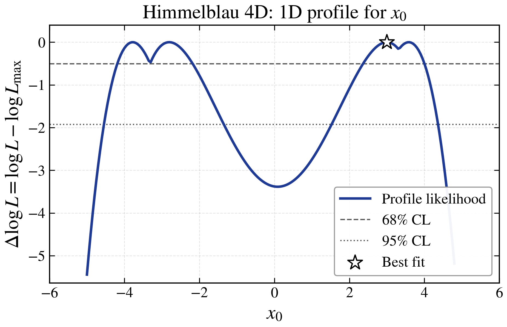
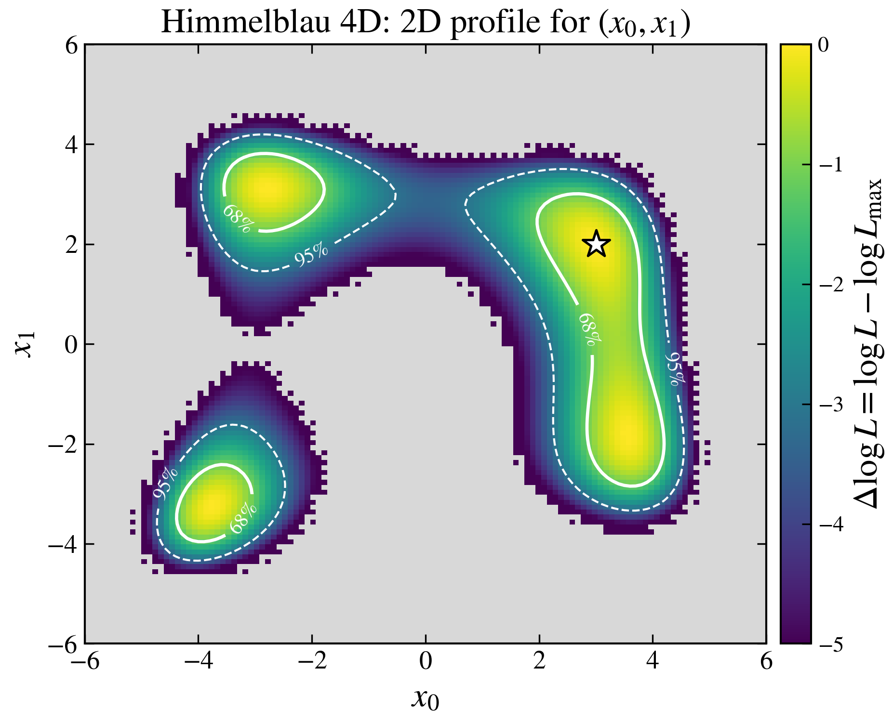
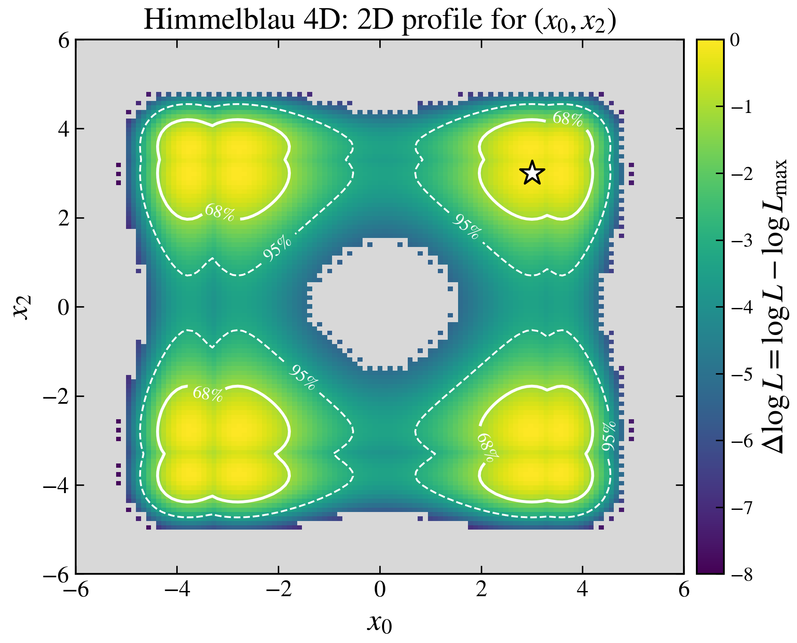
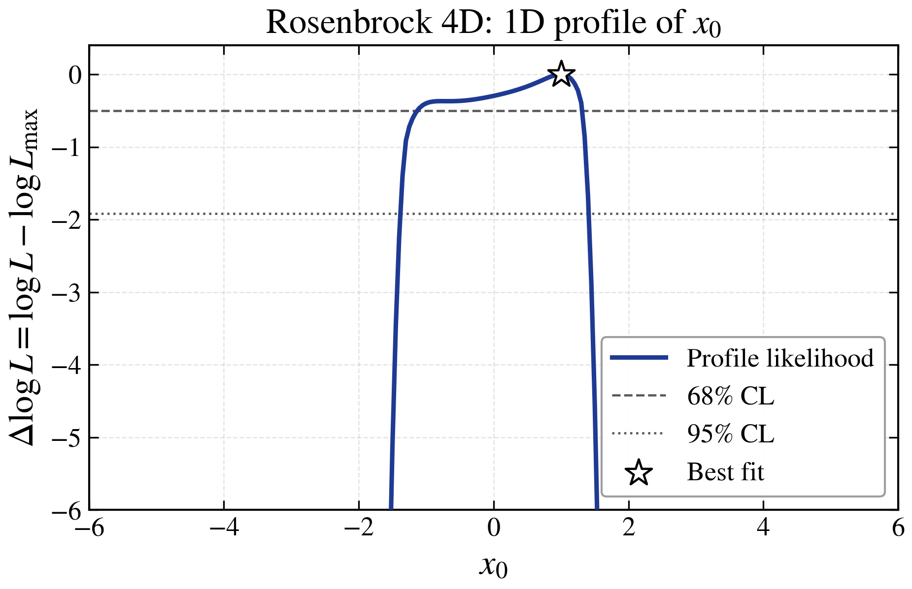
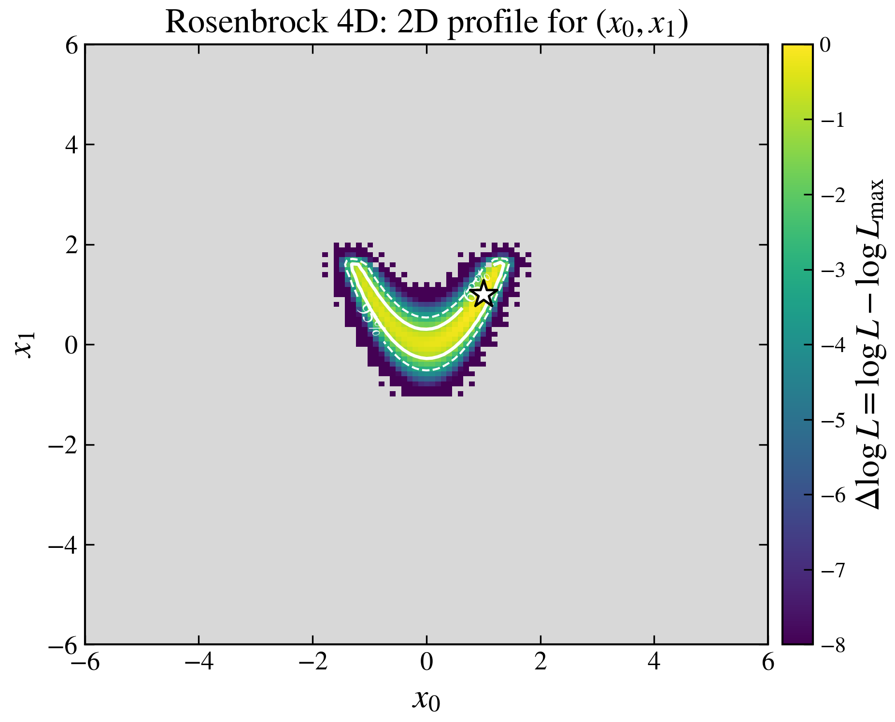
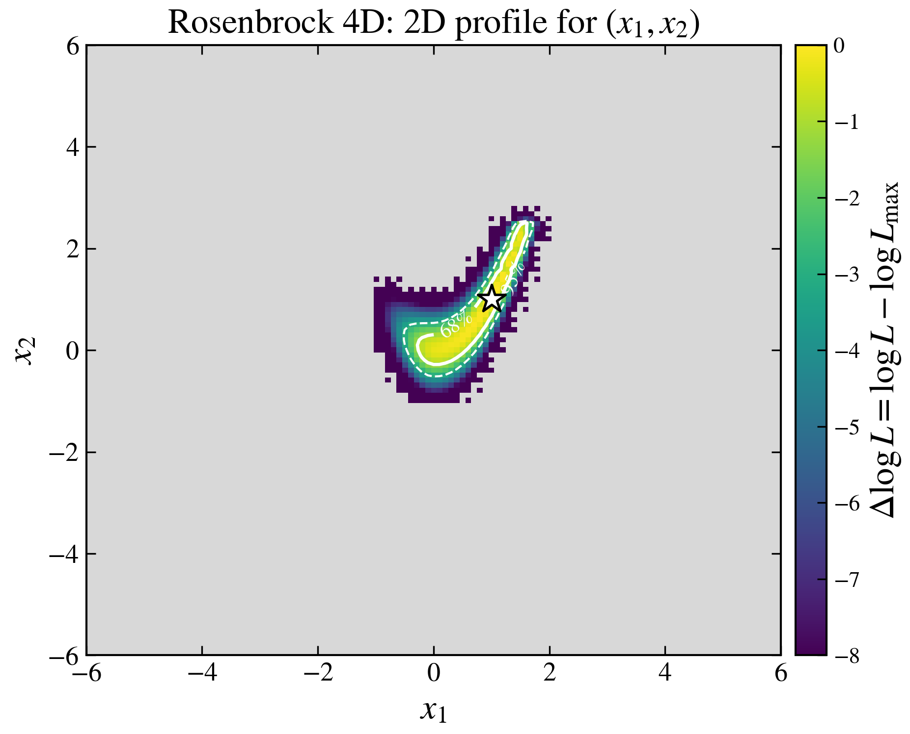
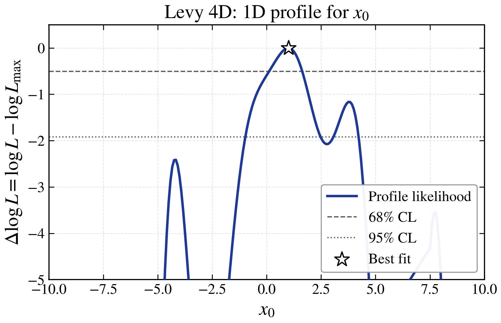
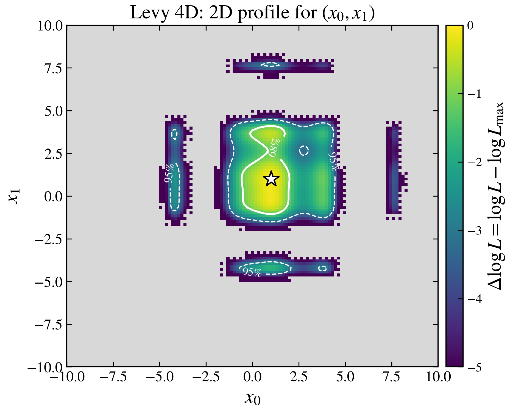
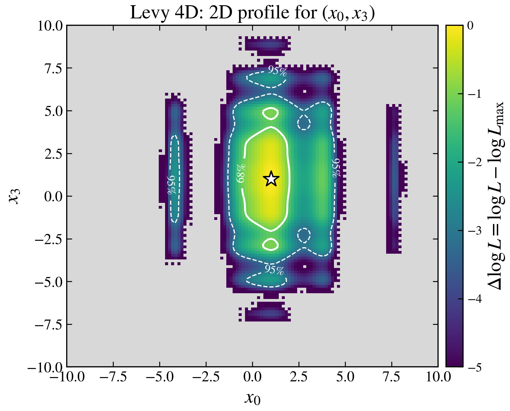

# paraprof

[](https://www.python.org/downloads/)
[](https://opensource.org/licenses/MIT)

**paraprof** is a robust and MPI-parallelised algorithm for computing profile likelihood projections – or more generally for mapping out low-dimensional projections of a target function by optimizing over the remaining dimensions.

First an initial global optimization identifies promising starting points. These starting points are used to activate initial grid points in the user-selected projection space. At each active grid point the remaining parameters are profiled (optimized) out using differential evolution (DE) and/or L-BFGS-B. If the optimized target value for a grid point meets the user-set threshold, the neighboring grid points are activated. This way the set of optimized grid points dynamically expands to cover the full region of interest, e.g. the high-likelihood region. Information from already converged grid points is communicated to neighboring grid points for faster convergence.


<p align="center">
  
</p>

## Installation

```bash
pip install git+https://github.com/anderkve/paraprof.git
```

Optional extras: `pip install -e ".[viz]"`, `".[dev]"`, or `".[all]"`.

Requires Python 3.10+, NumPy, SciPy, and mpi4py (with an MPI implementation like OpenMPI or MPICH). Matplotlib and scikit-learn are optional.


## Example output

Below are 1D and 2D projections of three 4D test functions used as example log-likelihood functions. Dimensions not shown on the axes are profiled out. The white star marks the best-fit point; the contours are 68% and 95% confidence regions (assuming Wilks' theorem). Plots come from `examples/run_showcase_scan.py` followed by `examples/make_showcase_plots.py`.

<p align="center">
  
  
  
</p>

Himmelblau 4D: 264,617 target-function evaluations across all three projections.

<p align="center">
  
  
  
</p>

Rosenbrock 4D: 63,904 evaluations.

<p align="center">
  
  
  
</p>

Levy 4D: 117,757 evaluations. The last dimension uses `sin(2π·w₃)` rather than `sin(π·w + 1)`, so the (x₀, x₃) projection has denser horizontal ridges than (x₀, x₁).


## Quick start

```python
from mpi4py import MPI
from paraprof import (
    ProfileProjector, run_all_projections, terminate_workers, worker_main,
    get_test_function,
)

comm = MPI.COMM_WORLD
myrank = comm.Get_rank()

log_likelihood, bounds, _ = get_test_function("himmelblau_4d")
projections = [
    {'dims': [0, 1], 'grid_points': [50, 50]},
]

if myrank == 0:
    with ProfileProjector(
        target_func=log_likelihood,
        bounds=bounds,
        projections=projections,
        roi_threshold=4.0,
        pop_per_grid_point=3,
    ) as sampler:
        comm.bcast(sampler.target_func, root=0)
        results = run_all_projections(
            comm=comm, sampler=sampler, projections=projections,
            save_plots=True,
        )
    terminate_workers(comm, myrank)
else:
    worker_main(comm, myrank)
```

Run with `mpiexec -n 4 python your_script.py`.

More examples live in `examples/`. The `*_advanced.py` scripts show the full `advanced_config` layout.

## How it works

Rank 0 is the master: it owns the grid, hands out optimization jobs, and tracks which cells are active. Ranks 1+ are stateless workers that evaluate `target_func` on demand.

A scan proceeds roughly as follows:

1. Lay a regular grid over the projection dimensions; the rest are profiled at each grid point.
2. Estimate the numerical noise of the target and choose the finite-difference step of the L-BFGS-B gradient from it (once per scan; skipped when the step is given or a gradient function is supplied).
3. Run global L-BFGS-B starts to find initial maxima. Rather than firing a fixed number of Latin-hypercube starts and hoping it was enough, paraprof runs a *rolling* multistart with **basin detection**: each converged optimum is clustered online into a registry of distinct optima, and a Bayesian stopping rule (Boender–Rinnooy Kan, restricted to region-of-interest optima) halts the stage once the expected number of undiscovered ROI optima drops below a threshold — aborting any still-running optimizations at that point so their remaining evaluations aren't wasted. `n_initial_optimizations` becomes the upper bound. On later projections these are seeded from an in-memory pool built up by earlier projections, often skipping the global step entirely.
4. Anchor a DE population (or an initial point for L-BFGS-B optimization) at each promising cell. One population slot is filled with the highest-fitness past evaluation nearest the cell (proximity warm-start), so later projections inherit useful starting points.
5. Optimize the profiled parameters at each active cell. L-BFGS-B cells also reuse the best already-converged neighbour's quasi-Newton history and its best profiled parameters as an alternative start, propagating local curvature outward.
6. Activate the neighbours of high-likelihood cells, expanding the active set into the region of interest.
7. Patching: re-test each cell with its neighbours' best profiled parameters and polish any improvement.
8. Suspect recheck: cells whose profiled parameters look discontinuous compared to their neighbourhood are re-optimized from diverse seed points. This breaks contiguous wrong-optimum strips that the fitness-only filter of the patching step cannot fix.
9. Optionally refine the grid: interpolate the coarse grid to warm-start a finer one.

With several projections, the next one starts while the current one is still running, on workers the current one leaves idle. This happens once a tenth of the workers is idle and the newest projection has finished its first cell optimisation or DE generation. Earlier projections are served first. Projections with `grid_refinement_factor` or without profiled parameters are not overlapped. While projections overlap, log lines are prefixed with the projection number (`[P2]`), and the call count in a projection's `metrics` is that of the whole scan when the projection ended; `sampler.target_calls` holds the total. Set `cross_projection.eager_start` to `False` to run the projections one after another.

Key code paths: `ProfileProjector` (`sampler.py`) holds state and configuration, `master_main()` (`master.py`) is the state machine, `worker_main()` (`worker.py`) is the evaluation loop, and `jobs/` contains the asynchronous optimization jobs.

## Configuration

Common constructor arguments:

- `roi_threshold` — region-of-interest cutoff in log-likelihood; cells with `logL > global_max - roi_threshold` are inside the ROI. Default 4.0.
- `pop_per_grid_point` — DE population size per cell. Default 3.
- `n_initial_optimizations` — cap on global L-BFGS-B starts before grid optimization. Default `min(400, 50 * n_dims)`: a safe ceiling, since the Bayesian stopping rule controls the actual spend, so set it generously. (If you disable early stopping with `basin_detection.undiscovered_threshold = 0`, this becomes a fixed count, so set it explicitly.)
- `max_patching_waves` — cap on patching iterations. Default 10.
- `lbfgsb_max_iter`, `lbfgsb_polish` — L-BFGS-B iteration cap and whether to polish DE results. Defaults 50 and `True`.
- `n_optima` — prior on how many optima the target has *globally*; use only when sure it has one or a few. Stops the initial multistart as soon as that many distinct optima are found (the global max is then among them, so the `min_starts` floor is skipped — `n_optima=1` stops after the first converged start), or keeps it running until at least that many are found. Pass an `int` (exact) or `{'min': int, 'max': int}`. Big saver on multimodal targets where the Bayesian rule would otherwise run to the cap.
- `initial_points` — explicit starting points to activate; useful when you already know where the good regions are. They replace the global L-BFGS-B starts and are evaluated, not optimised.
- `periodic` — parameters whose bounds span exactly one period (indices, or names with `parameter_names`), e.g. an angle on `[0, 2π]`. See [Periodic parameters](#periodic-parameters).
- `refine_initial_points` — run one L-BFGS-B optimisation over all parameters from every entry of `initial_points` before the grid points are activated. Default `False`. Without it the best initial point stands as the maximum unless a grid point exceeds it, so set it when the points are near the maximum but not known to be at it.
- `use_clustering` — detect multiple modes during refinement. Default `True`.
- `refinement_direct_eval` — skip optimization in the refinement run and just evaluate the interpolated point. Default `False`.
- `samples_output_file` — path to log every evaluation as `[params…, logL, phase]`; the `phase` column tags which algorithm stage produced each point (see [Sample file formats](#sample-file-formats)). The format is chosen from the extension: `.csv` for plain text or `.h5`/`.hdf5` for HDF5 binary (needs the optional `h5py` dependency).
- `warm_start_file` — sample file read at the start of each projection to pre-populate `initial_maxima`. Any supported format is accepted (the extension selects the reader). Set this equal to `samples_output_file` to feed a run's samples into the next one.
- `grad_func` — analytic gradient (see below).

### Periodic parameters

By default every parameter lives on a closed interval. Cells are activated from their grid neighbours and optimisers stop at the bounds. For an angle that is wrong at the ends of the range: `0` and `2π` are the same point, but the first and the last grid point are not neighbours. A region of interest that runs through the bound is then found only on the side the scan started from, unless a global start happens to end on the other side.

```python
sampler = ProfileProjector(
    target_func=log_likelihood,
    bounds=[(0.0, 2 * np.pi), (0.0, 1.0), ...],
    periodic=[0],          # or names, with parameter_names
    ...
)
```

The bounds of a periodic parameter must span exactly one period. What changes:

- As a projection dimension, the two grid points on the bound are neighbours of each other and of the grid points next to either. Both are still evaluated, so the exported grid keeps its shape.
- As a profiled parameter, a value that leaves the bounds is wrapped to the other side instead of clipped. This holds for L-BFGS-B steps and finite-difference probes, differential-evolution trial points, activation samples and volume-sampling walkers.
- Differences between two values are taken the short way round: L-BFGS-B curvature pairs, differential-evolution mutation vectors, the discontinuity measure of the suspect recheck, merging of initial optima, and interpolation in grid refinement.

Before the scan the target is evaluated at the lower and the upper bound of each periodic parameter, at three base points (six evaluations per parameter). A difference is logged as a warning and the scan continues. With bounds that are not one period the scan still returns true target values, but cells and optimisers are continued from a point that is not the same point, and the profile near the bound can come out too low.

Limits: the clustering used in grid refinement compares raw parameter values, so a periodic profiled parameter that crosses its bound inside the region of interest can be split into two clusters there. The profile plots of such a parameter show a jump from one bound to the other where it crosses.

### User-supplied gradients

By default L-BFGS-B uses finite differences, which costs 2N (central difference) or N (forward difference) extra calls per gradient. If you have an analytic gradient, pass it via `grad_func`:

```python
def target(p):
    return -float(np.sum(p**2))         # log-likelihood, maximized

def grad(p):
    return -2.0 * np.asarray(p)         # ∇target_func

sampler = ProfileProjector(target_func=target, grad_func=grad, ...)
```

`grad_func` returns the gradient of the function being *maximized*; ParaProf negates internally. Getting the sign wrong sends L-BFGS-B uphill.

You can return either a length-`n_dims` array or a `{dim_index: value}` dict for partial gradients. Entries that are `NaN`/`±inf` (or dims missing from the dict) fall back to finite differences using `lbfgsb.gradient_method`.

Only the L-BFGS-B paths use the gradient; DE is gradient-free. `sampler.target_calls_saved_by_user_gradient` and `sampler.user_gradient_errors` track usage and fallbacks.

### Sample file formats

Each evaluated point is one row of the sample file: `[params…, logL, phase]` — the `n_dims` parameter values, the target value, and an integer phase tag for the algorithm stage that produced the point. The whole run logs to one file; filtering on the phase column recovers any subset (e.g. the volume-sampling points). The format follows the `samples_output_file` extension:

| Extension        | Format      | Notes                                                                 |
|------------------|-------------|-----------------------------------------------------------------------|
| `.csv` (default) | plain text  | Headerless, `%.10e` columns. No extra dependencies.                   |
| `.h5` / `.hdf5`  | HDF5 binary | ~Half the size and faster I/O. Requires `h5py` (`pip install paraprof[hdf5]`). |

Phase values (`paraprof.PHASE_*`, with descriptions in `paraprof.PHASE_LEGEND`):

| Phase | Constant | Meaning |
|-------|----------|---------|
| `0` | `PHASE_INITIAL` | initial optimization (global maxima / basin detection) |
| `1` | `PHASE_SCAN` | projection-grid scan (activation, DE, grid polish) |
| `2` | `PHASE_REFINE` | grid refinement and patching |
| `3` | `PHASE_SUSPECT` | suspect-cell recheck |
| `4` | `PHASE_VOLUME` | volume sampling (ensemble of MCMC walkers) |

Both formats round-trip through `warm_start_file`, so a run can append to and re-read its own file (the warm-start reader reads params and logL by position and ignores the phase column). They differ in crash safety: CSV re-opens per flush, so a crash loses at most the un-flushed buffer, while HDF5 keeps the file open and can truncate the final chunk on a hard kill — prefer CSV if that matters more than file size.

To pool several independent runs (or convert between formats), use `combine_samples`. It streams chunk by chunk and may mix formats:

```python
import glob
import numpy as np
from paraprof import combine_samples, read_samples, write_samples, PHASE_VOLUME

combine_samples(glob.glob("run_*/samples.*"), "all_samples.h5")

samples = read_samples("all_samples.h5")   # (n_samples, n_dims + 2) array
n_dims = samples.shape[1] - 2
params, target, phase = samples[:, :n_dims], samples[:, n_dims], samples[:, -1]

write_samples(samples[target > target.max() - 4.0], "roi.csv")        # filter by logL
volume_samples = samples[phase == PHASE_VOLUME]                        # filter by phase
```

`read_samples`/`write_samples` are the one-shot load/save pair (`write_samples` refuses to clobber an existing file unless `overwrite=True`). For very large files, iterate with `paraprof.sample_io.iter_sample_batches(path)` instead of loading the whole array.

### Volume sampling

A profile-likelihood scan samples only the low-dimensional profile *surfaces* — a vanishingly thin slice of the full good-fit volume. To also get points throughout the region of interest (or just outside it, to see *why* nearby regions fail), enable the volume-sampling stage that runs after the projections:

```python
sampler = ProfileProjector(
    ...,
    samples_output_file="samples.csv",   # walkers warm-start from these
    volume_sampling={
        'n_walkers': 1000,      # ensemble size
        'n_steps': 30,          # steps per walker
        'output_file': "volume_samples.csv",
        # 'roi_threshold': 25.0,  # widen the stage's ROI to also sample
        #                         # just outside the good-fit region
    },
)
```

The stage fills the region of interest `{logL > global_max − roi_threshold}` with samples spread through the volume and across fit quality (not piled up near the threshold). It runs an affine-invariant ensemble of MCMC walkers (Goodman–Weare stretch move), each pinned to a target logL level so the ensemble spans the full range. Walkers are seeded inside the converged profile grids — which bound logL from above — and warm-started from the logged scan samples. See `examples/run_volume_sampling.py`.

Every evaluation streams into the main sample log under `PHASE_VOLUME`. The stage also writes:

- `output_file` (`.csv`/`.h5`) — the in-ROI samples, one row `[params..., logL]` each.
- `summary_file` (JSON) — walker/step/evaluation counts, in-ROI fraction, mean acceptance, and the logL histogram.
- `sampler.volume_stage_result` — the same in memory, plus the `samples` array.

Useful knobs:

- `n_walkers` — ensemble size; the output sample count scales with it. Default 1000.
- `n_steps` — steps per walker; longer chains mix better. Default 30.
- `eval_budget` — cap on total evaluations. Default `n_walkers·(n_steps+1)`.
- `sigma_frac` — how tightly each walker is held to its logL level, as a fraction of `roi_threshold`; smaller sharpens the logL spread but lowers acceptance. Default 0.1.
- `roi_threshold` — the stage's own ROI cutoff in logL; larger reaches just outside the good-fit region. Defaults to the projection's value.
- `partner_level_window` — restrict a walker's stretch-move partners to those near its logL level. Default `None`.
- `warm_start` — seed walkers from logged scan samples rather than fresh draws. Default `True`.

Plot with `plot_volume_samples(sampler.volume_stage_result, dims=(0, 1), filename=..., grid_solution=...)` to scatter the samples (coloured by logL) over a 2D profile map.

The samples are MCMC draws, so they are autocorrelated — read them as well-spread coverage, not an i.i.d. draw. The top of the logL range can be under-filled (raise `n_steps`/`n_walkers`), islands the scan missed can stay missed, and in high dimensions they are representatives rather than a dense filling.

### Advanced configuration

Pass an `advanced_config` dict for the knobs that actually move solution quality or are real iteration budgets:

| Key                                | Default                        | What it does                                                     |
|------------------------------------|--------------------------------|------------------------------------------------------------------|
| `memory_size`                      | `max(grid_sizes) * 25`         | DE F/CR adaptation memory size                                   |
| `convergence_threshold`            | `1e-6`                         | DE per-cell convergence cutoff                                   |
| `de.convergence_window`            | `3`                            | Generations of no-improvement before DE declares convergence     |
| `de.allow_early_DE_exit`                | `True`                         | Smooth-interior cells (neighbour argmax agreement) skip the DE search — 1 DE generation then polish, instead of the full window (see below). Set `False` for multimodal-inner targets |
| `de.num_generations`               | `100000`                       | Hard cap on DE generations                                       |
| `de.max_num_to_evolve`             | `None`                         | Cap on cells evolved per generation                              |
| `lbfgsb.ftol`                      | `1e-9`                         | L-BFGS-B function tolerance. For a profile likelihood `1e-4` is far below what a contour shows and saves iterations |
| `lbfgsb.gradient_method`           | `'forward'`                    | `'forward'` or `'central'` (~50% more calls)                     |
| `lbfgsb.fd_step`                   | `'auto'`                       | Finite-difference step as a fraction of the bound extent. `'auto'` sets it from a noise estimate of the target |
| `lbfgsb.activation_depth` | `1` | How many cells ahead a cell inside the region of interest activates while workers are idle. Above 1 the extra cells get only idle workers and are dropped if they stay outside the border: the result holds the same cells. On a simulated 25 × 25 plane depth 2 cut the wall time by 12 % on 1000 workers for 46 % more evaluations, by 5 % on 300, and added 5 % on 100 |
| `clustering.*`                     | auto-DBSCAN                    | Mode detection during refinement                                 |
| `cross_projection.proximity_warm_start`       | `True`             | Swap one LHS seed for the best nearby past evaluation. |
| `cross_projection.pool_seeded_initial_maxima` | `True`             | Seed `initial_maxima` from the pool on later projections and skip the global L-BFGS-B starts. |
| `cross_projection.eager_start`                | `True`             | Start the next projection while the current one runs, on workers it leaves idle. Work is handed out in the order the projections were started. Not for projections with `grid_refinement_factor`. Set `False` to run the projections one after another. |
| `suspect_recheck.enabled`                     | `True`             | Run the suspect-cell recheck pass after patching. |
| `suspect_recheck.max_waves`                   | `10`               | Cap on suspect-recheck waves. |
| `suspect_recheck.param_k`                     | `3.0`              | MAD multiplier for the discontinuity threshold. Lower flags more cells. |
| `suspect_recheck.max_fraction`                | `0.25`             | Hard cap on the fraction of ROI cells flagged per wave. |
| `suspect_recheck.seeds_k_ring`                | `3`                | Max Chebyshev radius for extended-neighbour seeds. |
| `suspect_recheck.seeds_from_pool`             | `3`                | Cross-projection pool seeds tested per suspect cell. |
| `suspect_recheck.polish_threshold`            | `1e-3`             | Min logL improvement to trigger the L-BFGS-B polish. |
| `basin_detection.batch_size`                  | `None`             | Optimizations kept in flight at once in the rolling multistart. `None` = FD-aware auto (≈ `n_workers` / per-gradient finite-difference fan-out, floored at 2). |
| `basin_detection.undiscovered_threshold`      | `0.5`              | Stop once the expected number of undiscovered ROI optima falls below this. Higher = stops sooner; `0` disables early stopping (the stage then runs the full `n_initial_optimizations`). |
| `basin_detection.min_starts`                  | `None`             | Minimum starts before the stopping rule may fire. `None` = `max(10, 3·n_dims)` (capped at `n_initial_optimizations`). |

**L-BFGS-B on a target with numerical noise.** A likelihood that contains an iterative solver, a tabulated input or an ill-conditioned linear solve returns values that scatter between neighbouring points. A finite-difference step sized for double precision then measures that scatter instead of the slope. With `lbfgsb.fd_step='auto'` paraprof estimates the noise before the first optimisation (the ECNoise procedure of Moré and Wild, about 60 evaluations) and logs it together with the step it chooses:

```
--- Noise of the target: 1.07e-09; curvature scale: 3.35e+02; finite-difference step: 3.0e-06 of the bound extent ---
```

A noise level far above `1e-12` is worth a look at the target: it also limits how far any optimiser can converge.

**L-BFGS-B on many workers.** One L-BFGS-B iteration is a gradient (one evaluation per parameter, in parallel) and a line search. The trial steps of the line search form a fixed ladder, and the step accepted is the first one that passes the Armijo test, so the ladder can be evaluated ahead of time. When workers are idle the master hands them later rungs and the gradient probes of the first rung; if that rung is accepted, the next iteration starts without waiting. A run over at most 12 parameters also measures its Hessian in the same parallel step, takes Newton steps, and passes the Hessian on to neighbouring cells. In `'lbfgsb'` projections cells are activated and optimised as results arrive rather than wave by wave. `tools/bench_scheduling.py` measures the effect for a given number of workers without MPI, on virtual workers (`tools/virtual_pool.py`).

**Usage:** with basin detection on, set `n_initial_optimizations` generously — it caps the worst case, while the stopping rule keeps the actual spend proportional to how multimodal the target turns out to be. Easy targets stop early; hard ones use the budget.

**Early exit from the DE search on smooth cells (`de.allow_early_DE_exit`, on by default).** Every active grid cell normally spends at least `de.convergence_window` DE generations just *confirming* convergence — budget largely wasted on the smooth ROI interior. With `de.allow_early_DE_exit=True` (the default), a freshly activated cell whose in-population neighbours agree on the profiled argmax (and whose neighbour warm-start was the best activation seed) runs a **single** DE generation then goes straight to the L-BFGS-B polish. That generation still runs, so the exit is self-correcting — a cell that improves keeps evolving. A replicate study (`examples/run_allow_early_de_exit_replicate_study.py`) shows a clean win on unimodal-inner targets — Himmelblau-4D −13.7% and Rosenbrock-4D −10.9% target calls (both *p* < 0.01), ROI quality indistinguishable from baseline. Set `de.allow_early_DE_exit=False` for a genuinely multimodal *inner* problem (e.g. Rastrigin-4D), where one DE generation under-explores the modes and ROI quality degrades; the default suits targets where the profiled-out dimensions enter smoothly (e.g. Gaussian-constrained nuisances).

See the `ProfileProjector` docstring for the full structure. Several DE knobs that did not change ROI quality in benchmarking (`mutation_strategy`, `pbest_fraction`, `neighbor_pull_probability`, `global_pool_size`, `patching.n_neighbors`, `activation.mix_ratios`) are module-level constants in `sampler.py` and are intentionally not user-tunable.

### Projection options

Each projection is a dict. Required: `dims` (parameter indices) and `grid_points` (resolution per dimension). Optional: `optimization_method` (`'de'` or `'lbfgsb'`, default `'de'`), `patch_coarse_grid` (default `True`), `patch_refined_grid` (default `False`), `grid_refinement_factor` (integer > 1 to enable refinement), and `refinement_method` (default `'linear'`).

## Visualization

With `save_plots=True`, paraprof writes 1D line plots, 2D heatmaps with contours, and pairwise 2D slices for higher-dimensional projections (either the max slice or marginalized). It also writes plots of the optimal profiled-parameter values across the projection grid, which is useful for seeing what the profiling actually did.

Override the defaults with a `plot_settings` dict:

```python
plot_settings = {
    'dpi': 300,
    'filetype': 'png',
    'slice_mode': 'max',  # or 'all' for marginalization (3D+)
    'vmin': -4.0,
    'vmax': 0.0,
    'plot_profiled_params': True,
    'output_dir': '.',  # created automatically if missing
}
```

## Testing

```bash
pytest tests/ -v
pytest tests/ -v --cov=src/paraprof --cov-report=term-missing
```

## Project structure

```
paraprof/
├── src/paraprof/
│   ├── sampler.py            # ProfileProjector (state + config)
│   ├── master.py             # Master event loop
│   ├── worker.py             # Worker event loop
│   ├── jobs/                 # Optimization jobs (LBFGSB, DE, activation, patching, noise estimate)
│   ├── interpolation.py      # Grid interpolation + clustering for refinement
│   ├── visualization.py      # Plot helpers
│   ├── nuisance_wrapper.py   # Wrap test functions with nuisance parameters
│   ├── test_functions.py     # Himmelblau, Rosenbrock, Rastrigin, etc.
│   ├── exceptions.py
│   └── logger.py
├── tests/
├── tools/                    # virtual_pool.py (master on virtual workers), bench_scheduling.py
└── examples/                 # `*_advanced.py` exercises advanced_config
```

## License

MIT — see [LICENSE](LICENSE).

## Citation

```bibtex
@software{paraprof2025,
  title = {paraprof},
  author = {Kvellestad, Anders},
  year = {2025},
  url = {https://github.com/anderkve/paraprof}
}
```

Maintainer: Anders Kvellestad.
